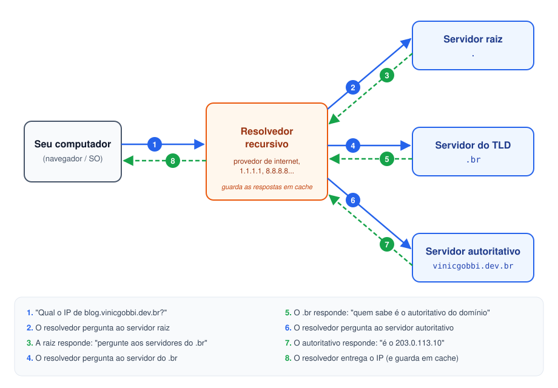

## Introdução

Sejam bem-vindos a mais um post! Dessa vez quero falar sobre algo que você usa centenas de vezes por dia, provavelmente sem nem perceber: o **DNS**.

Toda vez que você abre um site, manda uma mensagem ou até quando um app no celular atualiza sozinho, existe uma pequena "conversa" acontecendo nos bastidores para descobrir *para onde* aquela informação deve ir. Bora entender como isso funciona?

## O problema: computadores não entendem nomes

Na internet, cada dispositivo é identificado por um **endereço IP**, algo como `203.0.113.10` (IPv4) ou `2001:db8::10` (IPv6). É por esse número que os computadores se encontram e trocam dados.

O problema é que nós, humanos, somos péssimos para decorar números. Imagina ter que lembrar o IP de cada site que você acessa? É muito mais fácil lembrar de `blog.vinicgobbi.dev.br` do que de uma sequência de números que, ainda por cima, pode mudar com o tempo.

É aí que entra o **DNS** (*Domain Name System*, ou Sistema de Nomes de Domínio): ele é o responsável por traduzir nomes que a gente entende em endereços IP que os computadores entendem.


_O DNS funciona como a agenda de contatos da internet_

A melhor analogia que eu conheço é a da **agenda do celular**: você não decora o número de todo mundo, você procura pelo nome "Mãe" e a agenda te devolve o número. O DNS faz exatamente isso, só que para a internet inteira.

> Os IPs usados neste post (`203.0.113.10` e `2001:db8::10`) são endereços reservados para documentação e exemplos, ou seja, não apontam para nenhum servidor real.
{: .prompt-info }

## Anatomia de um domínio

Antes de ver como a consulta acontece, vale entender como um nome de domínio é organizado. O DNS é **hierárquico**, parecido com uma árvore genealógica (ou com a estrutura de pastas do seu computador), e o nome é lido **da direita para a esquerda**, do mais geral para o mais específico.


_A árvore do DNS, destacando o caminho até blog.vinicgobbi.dev.br_

Pegando o endereço deste blog como exemplo:

- **`.` (raiz):** o topo da árvore. Normalmente fica escondido, mas todo domínio termina com um ponto: `blog.vinicgobbi.dev.br.`
- **`br` (TLD):** o *Top-Level Domain*, ou domínio de topo. Existem os genéricos (`.com`, `.org`, `.dev`) e os de países (`.br`, `.pt`, `.us`). O `.br` é administrado aqui no Brasil pelo [Registro.br](https://registro.br/).
- **`dev`:** uma das categorias que existem dentro do `.br`, assim como `com.br`, `net.br`, `blog.br` e várias outras.
- **`vinicgobbi`:** o domínio que eu registrei.
- **`blog`:** um subdomínio, que eu mesmo crio e gerencio dentro do meu domínio, sem precisar pedir para ninguém.

Essa organização é o que permite que o DNS seja **descentralizado**: ninguém precisa conhecer todos os nomes do mundo, cada nível só precisa saber quem é responsável pelo nível logo abaixo.

## Os personagens dessa história

Para uma consulta DNS acontecer, quatro "personagens" principais participam:

1. **Resolvedor recursivo:** é o "detetive" que sai perguntando por aí até encontrar a resposta. Normalmente é o servidor DNS do seu provedor de internet, mas pode ser um público, como o `1.1.1.1` (Cloudflare), `8.8.8.8` (Google) ou `9.9.9.9` (Quad9).
2. **Servidores raiz:** ficam no topo da hierarquia. Existem 13 "identidades" de servidores raiz (de `a.root-servers.net` até `m.root-servers.net`), mas cada uma delas é na verdade um conjunto de centenas de servidores espalhados pelo mundo, inclusive no Brasil. Eles não sabem o IP de nenhum site, mas sabem quem cuida de cada TLD.
3. **Servidores de TLD:** cuidam de um domínio de topo, como o `.br` ou o `.com`. Também não sabem o IP final, mas sabem quais são os servidores responsáveis por cada domínio registrado.
4. **Servidor autoritativo:** é quem tem a resposta definitiva. É nele que ficam configurados os registros do domínio, normalmente no painel do serviço onde você gerencia o seu DNS (o próprio Registro.br, Cloudflare, etc).

## Como funciona uma consulta, passo a passo

Agora sim, juntando tudo! Vamos imaginar que você digitou `blog.vinicgobbi.dev.br` no navegador e o seu computador não faz ideia de qual é o IP dele:


_O caminho completo de uma consulta DNS_

1. O seu computador pergunta ao **resolvedor recursivo**: "qual o IP de `blog.vinicgobbi.dev.br`?"
2. O resolvedor, se não souber a resposta, vai até um **servidor raiz**.
3. A raiz responde: "não sei, mas quem cuida do `.br` são estes servidores aqui".
4. O resolvedor então pergunta aos **servidores do `.br`**.
5. Eles respondem: "também não sei o IP, mas o servidor autoritativo de `vinicgobbi.dev.br` é este aqui".
6. O resolvedor pergunta ao **servidor autoritativo**.
7. Finalmente vem a resposta: "o IP é `203.0.113.10`".
8. O resolvedor devolve o IP para o seu computador, que agora consegue se conectar ao site.

Parece muita coisa, mas tudo isso acontece normalmente em poucos milissegundos. E na prática, na maioria das vezes, nem todos esses passos são necessários, graças ao **cache**.

## Cache e TTL: o segredo da velocidade

Se toda consulta precisasse passar pela raiz, os servidores raiz seriam bombardeados o tempo todo e a internet seria bem mais lenta. Para evitar isso, as respostas ficam guardadas em **cache** em vários lugares:

- no **navegador**;
- no **sistema operacional**;
- no **roteador** da sua casa (em muitos casos);
- e principalmente no **resolvedor recursivo**, que atende milhares de pessoas ao mesmo tempo.

Então, se alguém que usa o mesmo provedor que você acessou o site há pouco tempo, o resolvedor já tem a resposta pronta e nem precisa sair perguntando.

Mas por quanto tempo essa resposta fica guardada? Isso é definido pelo **TTL** (*Time To Live*), um valor em segundos que o dono do domínio configura em cada registro. Um TTL de `3600`, por exemplo, diz: "pode guardar essa resposta por até 1 hora".

> É por causa do TTL que, quando você muda o IP de um domínio, a alteração não aparece para todo mundo na hora. Muita gente chama isso de "propagação de DNS", mas na verdade não tem nada se propagando: os caches espalhados pelo mundo só estão esperando o TTL antigo expirar para buscar a informação nova.
{: .prompt-tip }

## Tipos de registros DNS

O DNS não serve só para descobrir o IP de um site. No servidor autoritativo existem vários **tipos de registros**, cada um com uma função. Os mais comuns são:

| Tipo      | Para que serve                                                     | Exemplo                                                    |
| --------- | ------------------------------------------------------------------ | ---------------------------------------------------------- |
| **A**     | Aponta um nome para um endereço IPv4                                | `blog.vinicgobbi.dev.br → 203.0.113.10`                    |
| **AAAA**  | Aponta um nome para um endereço IPv6                                | `blog.vinicgobbi.dev.br → 2001:db8::10`                    |
| **CNAME** | Cria um "apelido", apontando um nome para outro nome                | `www.exemplo.com.br → exemplo.com.br`                      |
| **MX**    | Indica quais servidores recebem os e-mails do domínio               | `exemplo.com.br → mail.exemplo.com.br`                     |
| **TXT**   | Guarda textos livres, muito usado para verificações e segurança de e-mail (SPF, DKIM, DMARC) | `"v=spf1 include:_spf.google.com ~all"` |
| **NS**    | Diz quais são os servidores autoritativos do domínio                | `vinicgobbi.dev.br → ns1.provedor-dns.com`                 |

Uma curiosidade: quando você hospeda um site no GitHub Pages, por exemplo, e configura um domínio próprio, normalmente você cria um registro **CNAME** apontando para `seu-usuario.github.io`, ou registros **A** apontando para os IPs do GitHub.

## Vendo na prática

Dá para brincar com DNS direto do terminal! No Linux (e no macOS) a ferramenta mais conhecida é o `dig`:

```bash
dig blog.vinicgobbi.dev.br
```

A parte mais importante da saída é a seção `ANSWER`, que vai ser parecida com isso:

```text
;; ANSWER SECTION:
blog.vinicgobbi.dev.br.  3600  IN  A  203.0.113.10
```

Repare nas informações: o nome (com o ponto da raiz no final!), o TTL em segundos, a classe (`IN`, de internet), o tipo do registro e o valor.

Alguns outros comandos legais para testar:

```bash
# Consultar um tipo específico de registro
dig vinicgobbi.dev.br MX

# Mostrar só a resposta, sem o resto da saída
dig +short blog.vinicgobbi.dev.br

# Perguntar diretamente para um resolvedor específico
dig @1.1.1.1 blog.vinicgobbi.dev.br

# Ver o caminho completo: raiz → TLD → autoritativo
dig +trace blog.vinicgobbi.dev.br
```

O `dig +trace` é o meu favorito, porque mostra na prática exatamente o passo a passo que vimos na imagem lá em cima.

> No Windows, o comando equivalente é o `nslookup`, que também existe no Linux: `nslookup blog.vinicgobbi.dev.br`. Se o `dig` não estiver instalado na sua distro, ele normalmente vem no pacote `bind-utils` (Fedora) ou `dnsutils` (Debian/Ubuntu).
{: .prompt-info }

## E a privacidade?

Um detalhe que pouca gente sabe: o DNS tradicional trafega **sem criptografia**. Isso significa que quem está no meio do caminho, como o seu provedor de internet ou alguém na mesma rede Wi-Fi pública, consegue ver quais sites você está acessando, mesmo que o site em si use HTTPS.

Para resolver isso, surgiram alternativas como:

- **DoH** (*DNS over HTTPS*): as consultas vão "disfarçadas" dentro de conexões HTTPS.
- **DoT** (*DNS over TLS*): as consultas vão em uma conexão criptografada dedicada.

Os navegadores mais populares, como Firefox e Chrome, já têm a opção de usar DNS seguro nas configurações, e no Android existe a opção "DNS privado", que usa DoT. Vale a pena dar uma olhada!

## Bônus: o arquivo hosts

Antes mesmo de consultar qualquer servidor DNS, o sistema operacional olha um arquivo local chamado **hosts**. Ele fica em `/etc/hosts` no Linux e macOS, e em `C:\Windows\System32\drivers\etc\hosts` no Windows.

```text
127.0.0.1   localhost
192.168.0.50   meu-servidor.local
```

Com ele, você pode "forçar" um nome a apontar para um IP específico apenas no seu computador, o que é muito útil para testes e desenvolvimento. Curiosamente, no começo da internet, era basicamente assim que tudo funcionava: existia um único arquivo hosts com todos os computadores da rede, que precisava ser baixado e atualizado manualmente. Conforme a rede foi crescendo, isso ficou impossível de manter, e foi justamente esse problema que levou à criação do DNS, lá em 1983.

## Considerações Finais

O DNS é uma daquelas tecnologias que ficam completamente invisíveis enquanto funcionam bem, mas quando dão problema, parece que a internet inteira caiu (e às vezes cai mesmo, não é à toa que existe o meme "*It's always DNS*" no meio de TI).

Espero que, depois desse post, da próxima vez que você digitar um endereço no navegador, lembre de toda essa conversa acontecendo em poucos milissegundos nos bastidores. E se quiser se aprofundar, recomendo muito abrir o terminal e brincar com o `dig +trace` em alguns sites que você usa no dia a dia!
